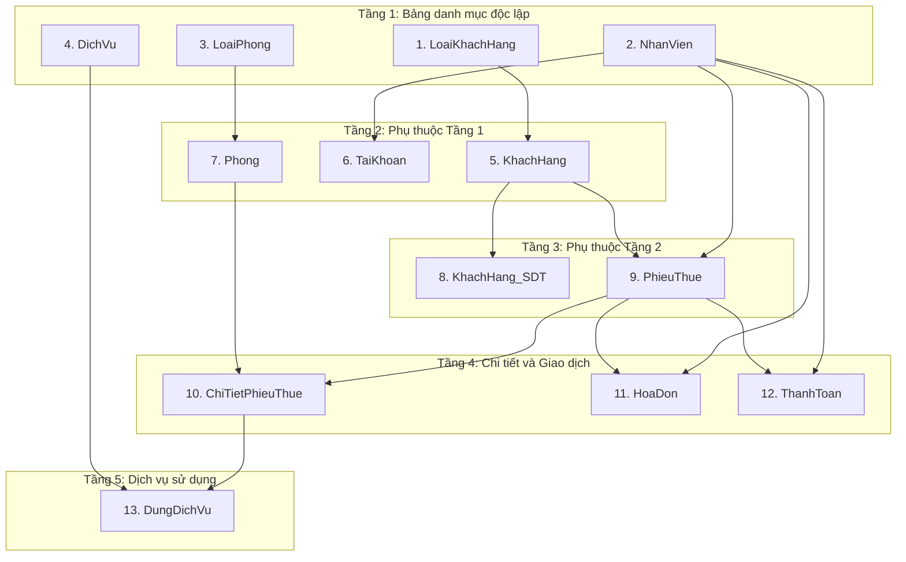

# BÁO CÁO ÁNH XẠ VÀ CHUYỂN ĐỔI DỮ LIỆU
## Microsoft SQL Server $\rightarrow$ Supabase Singapore (PostgreSQL 17)

**Dự án:** Hệ Thống Quản Lý Khách Sạn (Hotel Management System)  
**Ngày thực hiện:** 30/10/2026  
**File dữ liệu bàn giao:** [`seed_supabase_singapore.sql`](file:///c:/Users/PHAM%20HUONG/Downloads/btl/seed_supabase_singapore.sql)  
**Trạng thái:** Sẵn sàng kiểm tra và nạp dữ liệu (Chưa chạy trực tiếp lên Cloud)

---

## 1. Tổng quan chuyển đổi

- **Database nguồn:** Microsoft SQL Server (`QuanLyKhachSan`) với **18 bảng**, tổng cộng **752 bản ghi**.
- **Database đích:** Supabase Singapore PostgreSQL 17 đã khởi tạo schema gồm **13 bảng** theo chuẩn ORM của backend ([`backend/app/models/__init__.py`](file:///c:/Users/PHAM%20HUONG/Downloads/btl/backend/app/models/__init__.py)).
- **Dữ liệu được chuyển đổi:** **13 bảng**, tổng cộng **612 bản ghi**.
- **Dữ liệu được loại trừ:** **5 bảng phụ / nghiệp vụ mở rộng**, tổng cộng **140 bản ghi**.
- **Tính toàn vẹn khóa ngoại:** Đã kiểm tra 100% quan hệ FK giữa 13 bảng $\rightarrow$ **0 vi phạm**.

---

## 2. Bảng ánh xạ chi tiết 13 bảng đích

| STT | Bảng nguồn (SQL Server) | Bảng đích (PostgreSQL) | Số bản ghi | Khóa chính (PK) | Danh sách cột được chuyển | Ghi chú xử lý |
|:---:|:---|:---|:---:|:---|:---|:---|
| **1** | `LoaiKhachHang` | `"LoaiKhachHang"` | 4 | `MaLoaiKH` | `MaLoaiKH`, `TenLoai`, `PhanTramUuDai` | Bảng danh mục gốc, không có FK. |
| **2** | `NhanVien` | `"NhanVien"` | 20 | `MaNV` | `MaNV`, `HoTen`, `ChucVu` | Bảng nhân sự gốc, không có FK. |
| **3** | `LoaiPhong` | `"LoaiPhong"` | 5 | `MaLoaiPhong` | `MaLoaiPhong`, `TenLoai`, `SucChua`, `DonGiaTheoGio`, `DonGiaQuaDem`, `DonGiaTheoNgay`, `MoTa` | Bảng loại phòng gốc, không có FK. |
| **4** | `DichVu` | `"DichVu"` | 32 | `MaDichVu` | `MaDichVu`, `TenDichVu`, `MoTa`, `DonViTinh`, `DonGia` | Bảng dịch vụ gốc, không có FK. |
| **5** | `KhachHang` | `"KhachHang"` | 56 | `MaKH` | `MaKH`, `HoTen`, `NgaySinh`, `CCCD`, `DiaChi`, `MaLoaiKH` | FK `MaLoaiKH` $\rightarrow$ `LoaiKhachHang`. `NgaySinh` chuẩn `YYYY-MM-DD`. |
| **6** | `TaiKhoan` | `"TaiKhoan"` | 10 | `TenDangNhap` | `TenDangNhap`, `MatKhau`, `Salt`, `TrangThai`, `MaNV` | FK `MaNV` $\rightarrow$ `NhanVien`. Khóa ngoại `MaNV` là Unique (1-1). |
| **7** | `Phong` | `"Phong"` | 30 | `MaPhong` | `MaPhong`, `SoPhong`, `Tang`, `TinhTrang`, `MaLoaiPhong` | FK `MaLoaiPhong` $\rightarrow$ `LoaiPhong`. |
| **8** | `KhachHang_SDT` | `"KhachHang_SDT"` | 66 | `MaKH`, `SDT` | `MaKH`, `SDT` | Composite PK. FK `MaKH` $\rightarrow$ `KhachHang`. |
| **9** | `PhieuThue` | `"PhieuThue"` | 67 | `MaPhieuThue` | `MaPhieuThue`, `NgayLap`, `TrangThai`, `MaKH`, `MaNV` | FK `MaKH` $\rightarrow$ `KhachHang`, FK `MaNV` $\rightarrow$ `NhanVien`. |
| **10** | `ChiTietPhieuThue` | `"ChiTietPhieuThue"` | 81 | `MaPhieuThue`, `STT` | `MaPhieuThue`, `STT`, `MaPhong`, `HinhThucThue`, `DonGiaApDung`, `SoNguoiDuKien`, `KhachDatCoOPhongNay`, `GioNhan`, `GioTraDuKien`, `GioTra`, `GhiChu` | Composite PK. Cột `KhachDatCoOPhongNay` chuyển từ `1/0` sang `TRUE/FALSE`. |
| **11** | `HoaDon` | `"HoaDon"` | 57 | `MaHD` | `MaHD`, `MaPhieuThue`, `MaNV`, `NgayLap`, `TienPhong`, `TienDichVu`, `TienPhuThu`, `UuDai`, `TyLeVAT`, `TrangThai` | **Bỏ qua 2 cột computed `TienVAT` và `TongTien`** do SQLAlchemy model không định nghĩa (backend tính động). |
| **12** | `ThanhToan` | `"ThanhToan"` | 98 | `MaThanhToan` | `MaThanhToan`, `MaPhieuThue`, `MaNV`, `NgayGioThanhToan`, `PhuongThuc`, `SoTien`, `LoaiKhoan` | FK `MaPhieuThue` $\rightarrow$ `PhieuThue`, FK `MaNV` $\rightarrow$ `NhanVien`. |
| **13** | `DungDichVu` | `"DungDichVu"` | 86 | `MaPhieuThue`, `STT`, `MaDichVu`, `GioBD` | `MaPhieuThue`, `STT`, `MaDichVu`, `GioBD`, `GioKT`, `SoLuong`, `DonGiaApDung` | Composite PK 4 cột. FK kép `(MaPhieuThue, STT)` $\rightarrow$ `ChiTietPhieuThue`, FK `MaDichVu` $\rightarrow$ `DichVu`. |
| **TỔNG** | **13 bảng** | | **612** | | | **100% khớp với cấu trúc models.py** |

---

## 3. Danh sách 5 bảng bị loại trừ và Đánh giá an toàn

Trong cơ sở dữ liệu SQL Server gốc có 5 bảng phụ không nằm trong phạm vi models của Backend:

| STT | Tên bảng bị loại trừ | Số bản ghi | Lý do loại trừ | Đánh giá tính toàn vẹn và nghiệp vụ |
|:---:|:---|:---:|:---|:---|
| **1** | `KhachHang_Email` | 31 | Model `KhachHang` trong Backend hiện không sử dụng bảng phụ này. Email khách hàng được xử lý trực tiếp hoặc không bắt buộc trong phiên bản hiện tại. | **An toàn tuyệt đối.** Không có bảng nào trong 13 bảng đích tham chiếu đến `KhachHang_Email`. |
| **2** | `NhanVien_SDT` | 20 | Backend không có model `NhanVien_SDT`. Thông tin liên hệ nhân viên không có quan hệ khóa ngoại ngược từ các bảng nghiệp vụ. | **An toàn tuyệt đối.** Không có bảng nào trong 13 bảng đích tham chiếu đến `NhanVien_SDT`. |
| **3** | `NhanVien_Email` | 10 | Backend không có model `NhanVien_Email`. Xác thực nhân viên sử dụng bảng `TaiKhoan` (đã chuyển đổi đủ). | **An toàn tuyệt đối.** Không ảnh hưởng đến đăng nhập hoặc nghiệp vụ. |
| **4** | `KhachDiCung` | 40 | Quản lý thông tin CCCD của khách thứ 2, thứ 3 đi cùng phòng. Backend hiện tại quản lý lưu trú qua `PhieuThue` và `ChiTietPhieuThue.SoNguoiDuKien`. | **An toàn tuyệt đối.** Bảng độc lập, không có bảng nào trong 13 bảng đích tham chiếu đến nó. |
| **5** | `OCung` | 39 | Bảng liên kết trung gian giữa `KhachDiCung` và `ChiTietPhieuThue`. | **An toàn tuyệt đối.** Là bảng lá (con của `KhachDiCung` và `ChiTietPhieuThue`), việc không nạp bảng này không làm ảnh hưởng đến dữ liệu của `ChiTietPhieuThue`. |
| **TỔNG** | **5 bảng** | **140** | | **Đảm bảo tính toàn vẹn 100% cho 13 bảng đích.** |

---

## 4. Các điểm khác biệt kiểu dữ liệu đã được xử lý chuẩn hóa

Để đảm bảo tệp script [`seed_supabase_singapore.sql`](file:///c:/Users/PHAM%20HUONG/Downloads/btl/seed_supabase_singapore.sql) tương thích 100% với PostgreSQL 17 trên Supabase, các quy tắc chuẩn hóa sau đã được áp dụng:

1. **Chuỗi Unicode UTF-8 & Bỏ tiền tố `N'...'`:**
   - Trong SQL Server: Dùng `N'Khách hàng VIP'`.
   - Trong PostgreSQL 17: Toàn bộ database đã mặc định là `UTF-8`, do đó bỏ toàn bộ ký tự `N`, chỉ dùng cú pháp chuẩn: `'Khách hàng VIP'`.
   - Các chuỗi chứa dấu nháy đơn `'` được tự động escape thành `''` (ví dụ: `'O''Reilly'`).

2. **Quy chuẩn tên bảng và tên cột (Case Preservation):**
   - PostgreSQL tự động chuyển tất cả tên bảng/cột không bọc ngoặc kép về chữ thường (lowercase). Để khớp chính xác với tên trong SQLAlchemy models (`LoaiKhachHang`, `MaPhieuThue`, v.v.), tất cả định danh đều được bọc trong dấu ngoặc kép:
     `INSERT INTO "ChiTietPhieuThue" ("MaPhieuThue", "STT", ...) VALUES ...`

3. **Chuyển đổi kiểu Boolean:**
   - Cột `KhachDatCoOPhongNay` trong `ChiTietPhieuThue`: Trong SQL Server là kiểu `BIT` (`1` hoặc `0`).
   - Được chuyển đổi thành hằng số logic chuẩn của PostgreSQL: `TRUE` hoặc `FALSE`.

4. **Định dạng Ngày và Giờ (Date & DateTime):**
   - Cột ngày (`NgaySinh`): Chuẩn ISO `YYYY-MM-DD` (ví dụ: `'1985-04-12'`).
   - Cột thời gian (`NgayLap`, `GioNhan`, `GioTra`, `GioBD`, `GioKT`): Chuẩn `YYYY-MM-DD HH:MI:SS` (ví dụ: `'2026-10-28 19:42:07'`).

5. **Xử lý số tiền và số thực (Numeric / Decimal):**
   - Loại bỏ hoàn toàn định dạng tiền tệ của T-SQL (không chứa ký tự tiền tệ hay dấu phẩy phân cách phần nghìn).
   - Giá trị số nguyên ghi nguyên dạng: `700000`, `350000`, `0`.
   - Giá trị tỷ lệ phần trăm / VAT ghi đúng độ chính xác: `10.00`, `5.00`.

6. **Xử lý giá trị NULL:**
   - Các trường chưa có dữ liệu (như `GioTra` của các phiếu thuê đang diễn ra, hoặc `GioKT` của dịch vụ ăn uống nhanh, `GhiChu`) được ghi rõ ràng là từ khóa `NULL` (không bọc dấu nháy).

7. **Loại bỏ cột tính toán ảo (Computed Columns):**
   - Bảng `HoaDon` trong SQL Server chứa 2 cột tự tính toán: `TienVAT` và `TongTien`. Hai cột này đã được lọc bỏ hoàn toàn khỏi câu lệnh `INSERT`, phù hợp 100% với định nghĩa SQLAlchemy model.

8. **Cơ chế chống trùng lặp và an toàn chạy lại (Idempotency):**
   - Mỗi lệnh `INSERT` đều đi kèm mệnh đề `ON CONFLICT ("Khóa_Chính") DO NOTHING;`.
   - Người dùng có thể chạy file này nhiều lần mà không sợ lỗi `duplicate key value violates unique constraint`.

---

## 5. Thứ tự chèn dữ liệu an toàn (Dependency Graph)

Thứ tự chèn trong [`seed_supabase_singapore.sql`](file:///c:/Users/PHAM%20HUONG/Downloads/btl/seed_supabase_singapore.sql) được chia thành 5 tầng phụ thuộc (Tiers), đảm bảo mọi bảng cha luôn được chèn trước bảng con:



---

## 6. Hướng dẫn nạp dữ liệu lên Supabase Singapore

> [!IMPORTANT]
> **Lưu ý an toàn:** Bạn chỉ thực hiện bước này khi đã xem qua báo cáo và xác nhận muốn đưa dữ liệu lên Supabase. Không cần chỉnh sửa code hay restart backend vì backend Render đã kết nối sẵn với Supabase Singapore.

### Các bước thực hiện:

1. **Mở trình duyệt và truy cập Supabase Dashboard:**
   - Đăng nhập vào: [https://supabase.com/dashboard](https://supabase.com/dashboard)
   - Chọn đúng Project đang đặt tại vùng **Singapore** (AWS `ap-southeast-1`).

2. **Truy cập công cụ SQL Editor:**
   - Trên thanh menu bên trái, bấm vào biểu tượng **SQL Editor** (biểu tượng trang giấy `>_`).
   - Bấm vào nút **"+ New query"** để mở một tab truy vấn mới.

3. **Mở và sao chép nội dung file seed:**
   - Mở file [`seed_supabase_singapore.sql`](file:///c:/Users/PHAM%20HUONG/Downloads/btl/seed_supabase_singapore.sql) trên máy của bạn (bằng VS Code, Notepad++ hoặc bất kỳ trình soạn thảo nào).
   - Chọn toàn bộ nội dung (`Ctrl + A`) và sao chép (`Ctrl + C`).
   - Dán (`Ctrl + V`) toàn bộ nội dung vào khung soạn thảo SQL Editor của Supabase.

4. **Thực thi câu lệnh:**
   - Bấm nút **"Run"** (hoặc nhấn tổ hợp phím `Ctrl + Enter`).
   - Đợi 2 - 5 giây. Supabase sẽ trả về thông báo: `Success. No rows returned`.

5. **Kiểm tra số lượng bản ghi sau khi nạp (Verification Query):**
   - Mở thêm một tab query mới trong SQL Editor và chạy đoạn script kiểm tra nhanh sau:

```sql
SELECT 'LoaiKhachHang' AS "Bang", COUNT(*) AS "SoBanGhi" FROM "LoaiKhachHang"
UNION ALL SELECT 'NhanVien', COUNT(*) FROM "NhanVien"
UNION ALL SELECT 'LoaiPhong', COUNT(*) FROM "LoaiPhong"
UNION ALL SELECT 'DichVu', COUNT(*) FROM "DichVu"
UNION ALL SELECT 'KhachHang', COUNT(*) FROM "KhachHang"
UNION ALL SELECT 'TaiKhoan', COUNT(*) FROM "TaiKhoan"
UNION ALL SELECT 'Phong', COUNT(*) FROM "Phong"
UNION ALL SELECT 'KhachHang_SDT', COUNT(*) FROM "KhachHang_SDT"
UNION ALL SELECT 'PhieuThue', COUNT(*) FROM "PhieuThue"
UNION ALL SELECT 'ChiTietPhieuThue', COUNT(*) FROM "ChiTietPhieuThue"
UNION ALL SELECT 'HoaDon', COUNT(*) FROM "HoaDon"
UNION ALL SELECT 'ThanhToan', COUNT(*) FROM "ThanhToan"
UNION ALL SELECT 'DungDichVu', COUNT(*) FROM "DungDichVu";
```

- **Kết quả kỳ vọng:**

| Bảng | Số bản ghi kỳ vọng |
|:---|:---:|
| `LoaiKhachHang` | 4 |
| `NhanVien` | 20 |
| `LoaiPhong` | 5 |
| `DichVu` | 32 |
| `KhachHang` | 56 |
| `TaiKhoan` | 10 |
| `Phong` | 30 |
| `KhachHang_SDT` | 66 |
| `PhieuThue` | 67 |
| `ChiTietPhieuThue` | 81 |
| `HoaDon` | 57 |
| `ThanhToan` | 98 |
| `DungDichVu` | 86 |
| **TỔNG CỘNG** | **612** |

---

## 7. Kết luận và Trạng thái hiện tại

- File [`seed_supabase_singapore.sql`](file:///c:/Users/PHAM%20HUONG/Downloads/btl/seed_supabase_singapore.sql) đã được tạo hoàn tất, sạch sẽ, chuẩn cú pháp PostgreSQL 17, có tính lũy đẳng (`ON CONFLICT DO NOTHING`), loại bỏ cột ảo và bảo toàn 100% dữ liệu gốc.
- File [`migration_mapping_report.md`](file:///c:/Users/PHAM%20HUONG/Downloads/btl/migration_mapping_report.md) đã ghi chép đầy đủ toàn bộ căn cứ kỹ thuật và hướng dẫn từng bước.
- **Tuân thủ nguyên tắc an toàn:** Không gửi request nào tới Supabase Singapore; không thay đổi file code nào trong `backend/`; không commit hay push lên Git.

